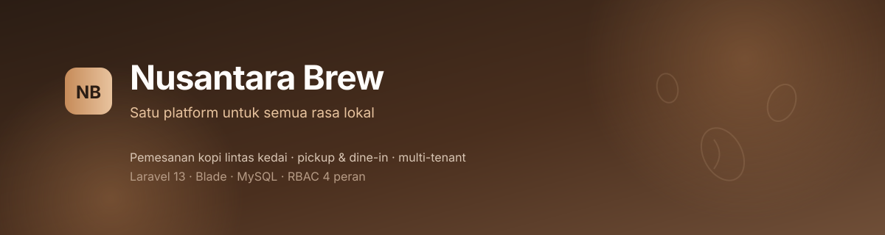

<div align="center">



<br>

**Platform pemesanan kopi lintas kedai.** Pelanggan memesan dari banyak coffee shop lokal dalam satu aplikasi, memilih ambil sendiri atau nikmati di tempat, sementara tiap kedai mengelola menu, stok, dan pesanannya sendiri.

<br>


[Ringkasan](#ringkasan) · [Fitur](#fitur) · [Peran](#peran-dan-hak-akses) · [Stack](#stack) · [Menjalankan](#menjalankan-di-lokal) · [Struktur](#struktur-proyek) · [Dokumen](#dokumen) · [Roadmap](#roadmap)

</div>

---

## Ringkasan

Satu akun, banyak kedai. Pelanggan menjelajah katalog, menaruh menu ke keranjang, lalu checkout ke **satu kedai per pesanan** aturan ini yang menjaga perhitungan pembayaran dan stok tetap sederhana. Di sisi lain, pemilik kedai mengelola katalog dan stafnya, barista menggerakkan antrean produksi, kasir melayani pesanan langsung di tempat, dan admin platform menyetujui kedai baru.

Proyek mata kuliah **Pengembangan Perangkat Lunak Web / Framework** yang dibangun dengan Laravel: MVC, relasi database, autentikasi, otorisasi berbasis peran, validasi, dan pengujian.

> Pembayaran pada tahap ini adalah **simulasi** (QRIS simulasi dan tunai). Tidak ada payment gateway nyata dan tidak ada dana yang diproses.

---

## Fitur

<table>
<tr><td width="50%" valign="top">

### Pelanggan
- Jelajah kedai aktif dengan pencarian
- Katalog menu per kedai, dikelompokkan per kategori
- Dialog detail menu dengan status stok
- Keranjang terikat satu kedai
- Checkout pickup atau dine-in dengan nomor meja
- Simulasi pembayaran QRIS / tunai
- Pelacakan status pesanan dan struk digital
- Riwayat pesanan lintas kedai

</td><td width="50%" valign="top">

### Pemilik kedai
- Ringkasan omzet dan pesanan hari ini
- Antrean pesanan masuk
- Katalog menu: harga, stok, ketersediaan
- Kategori menu dengan urutan tampil
- Profil kedai dan jam buka
- Buka/tutup penerimaan pesanan
- Penugasan staf lewat email
- Laporan penjualan per periode

</td></tr>
<tr><td valign="top">

### Barista & kasir
- Antrean kerja: baru, sedang dibuat, siap
- Detail pesanan dengan catatan item
- Layar kasir dengan pencarian menu dan keranjang
- Konfirmasi pembayaran tunai
- Struk siap cetak
- Riwayat pesanan kedai

</td><td valign="top">

### Admin platform
- Ringkasan kedai aktif dan pengajuan baru
- Persetujuan, aktivasi, penonaktifan kedai
- Manajemen akun dan status aktif
- Pembuatan akun owner/staf (tanpa pendaftaran publik)

</td></tr>
</table>

---

## Peran dan Hak Akses

| Peran | Cakupan data | Ringkas |
|---|---|---|
| `customer` | Pesanan miliknya | Memesan, membayar, melacak |
| `owner` | Kedai miliknya | Katalog, staf, laporan |
| `staff` | Kedai penugasan | Antrean dan kasir |
| `admin` | Seluruh platform | Persetujuan kedai dan akun |

Isolasi tenant ditegakkan di dua lapis: middleware peran pada route, dan pemeriksaan `coffee_shop_id` pada setiap akses data. Percobaan membuka data kedai lain harus menghasilkan `403`.

---

## Stack

| Lapis | Teknologi |
|---|---|
| Framework | Laravel 13 · PHP 8.5 |
| Tampilan | Blade · CSS kustom berbasis design token · JavaScript tanpa framework |
| Database | MySQL 8 (Eloquent + migration) |
| Pengujian | PHPUnit, feature test per halaman |
| Alat bantu | Composer · Artisan · Git |

CSS ditulis manual di `public/assets/css` dengan variabel warna terpusat (`tokens.css`), bukan utility framework, agar mudah ditinjau saat presentasi.

---

## Menjalankan di lokal

Prasyarat: PHP ≥ 8.2, Composer, MySQL.

```bash
# 1. Ambil kode
git clone https://github.com/Soerya-Gading/nusantara-brew.git
cd nusantara-brew

# 2. Dependensi
composer install

# 3. Konfigurasi
cp .env.example .env
php artisan key:generate
# sesuaikan DB_DATABASE, DB_USERNAME, DB_PASSWORD di .env

# 4. Database
php artisan migrate --seed

# 5. Jalankan
php artisan serve
```

Buka `http://127.0.0.1:8000`.

### Menjalankan pengujian

```bash
php artisan test
# atau
vendor/bin/phpunit
```

---

## Struktur proyek

```text
app/Http/Controllers/    PageController (data contoh), ShopController
resources/views/         layouts · partials · home · shops · auth · cart · checkout
                         orders · owner · staff · admin
public/assets/css/       tokens · base · components · dashboard · tables · pos · print
public/assets/js/        menu-dialog · pos · checkout · dashboard · order-countdown
routes/web.php           seluruh route bernama, dikelompokkan per peran
tests/Feature/           pengujian tampilan per halaman
docs/                    konsep sistem dan kontrak frontend–backend
```

---

## Dokumen

| Dokumen | Isi |
|---|---|
| [`docs/KONTRAK_FRONTEND_BACKEND.md`](docs/KONTRAK_FRONTEND_BACKEND.md) | Route, variabel view, field form, enum status, aturan middleware |
| [`docs/Nusantara_Brew_Konsep_Solid_v2.md`](docs/Nusantara_Brew_Konsep_Solid_v2.md) | Konsep sistem, aturan bisnis, model data |

---

## Roadmap

- [x] Konsep sistem dan aturan bisnis
- [x] Scaffold Laravel 13
- [x] Layout, design token, dan komponen dasar
- [x] Halaman pelanggan: katalog, detail kedai, keranjang, checkout, pesanan, struk, riwayat
- [x] Panel pemilik kedai: ringkasan, antrean, katalog, kategori, profil, staf, laporan
- [x] Panel staf: antrean, kasir, riwayat
- [x] Panel admin: ringkasan, persetujuan kedai, pengguna
- [x] Pengujian tampilan dan guard environment
- [ ] Migration, model, dan seeder
- [ ] Autentikasi dan middleware peran
- [ ] Keranjang dan checkout tersambung database
- [ ] Transaksi stok, kedaluwarsa pesanan, pengembalian stok
- [ ] Pengujian izin lintas tenant

---

## Tim

| Bagian | Penanggung jawab |
|---|---|
| Frontend Blade, CSS, pengujian tampilan | Soerya Gading Setya Pambayun |
| Backend transaksi, database, model | — |
| Akun, akses, CRUD pengelolaan, integrasi | — |

---

## Lisensi

Dirilis di bawah [MIT License](LICENSE). Proyek akademik, bukan layanan komersial.
